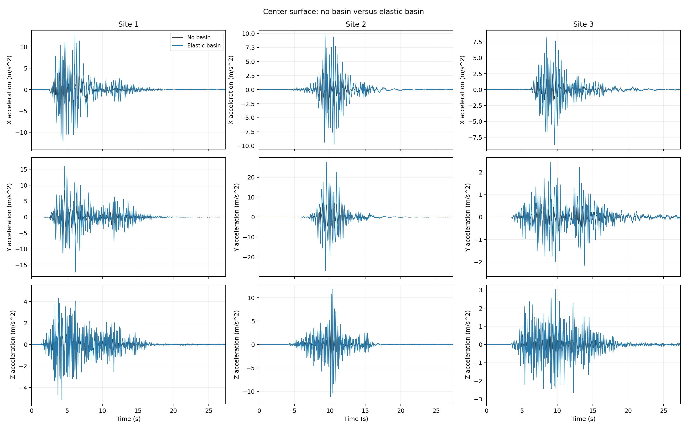
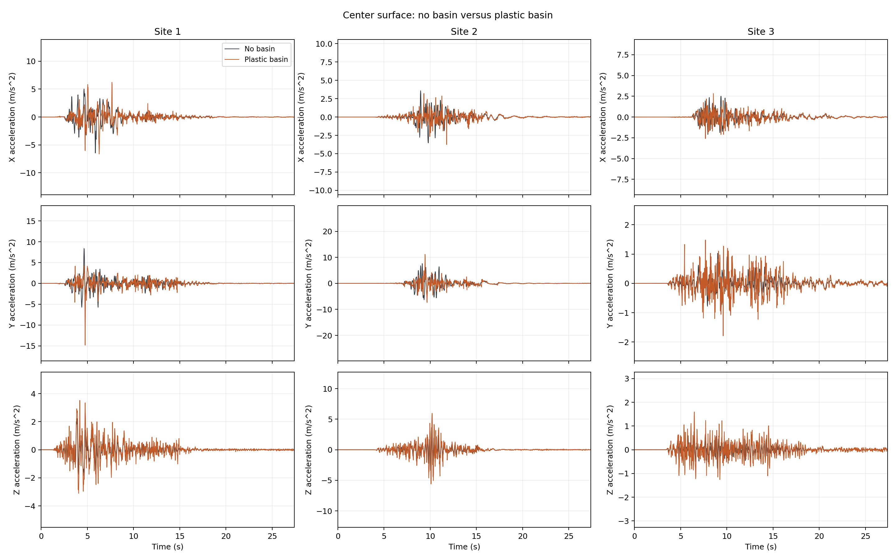
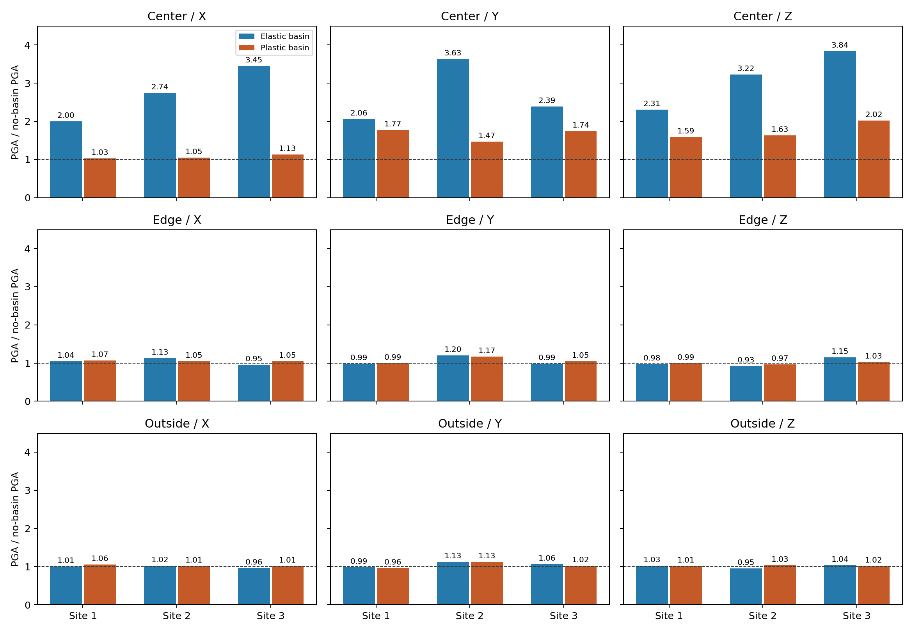

# Elastic and Plastic Basin

How does a soft soil basin change earthquake motion at the ground surface?
This example compares an elastic basin, a plastic basin, and a layered
background without a basin at three sites. It walks through model construction,
DRM excitation, surface-response interpretation, and remote workflow execution.

Within each site, the three configurations share the same geometry, mesh,
incoming wave field, and recording settings. The no-basin configuration assigns
the host layer's material, density, and damping to the basin cells. Comparing
against this background isolates the effect of the soft inclusion.

<div class="tutorial-actions" markdown>
[:material-code-braces: View source](https://github.com/GeotechUW/Femora/blob/main/examples/domain_reduction_method/basin.py){ .tutorial-action .tutorial-action--source }
</div>

## Regional Background

The incoming motions come from a physics-based **SW4 regional earthquake
simulation**, described by [Huang and McCallen (2025)](https://doi.org/10.1002/eqe.4350).
The scenario represents a magnitude Mw 6.5 strike-slip earthquake. SW4 computes
wave propagation from the fault through the regional geology, including a
sedimentary basin. Three DRM boxes extract the wave field at different sites.

=== "3D View"

    <iframe src="../../assets/viewer/viewer.html?scene=../scenes/basin-regional.js&amp;fallback=../examples/basin/regional_3d.png" title="Interactive regional basin, fault plane, and DRM sites" loading="lazy" style="width:100%;height:clamp(340px,65vw,720px);border:0;border-radius:6px"></iframe>

    [View static figure](../assets/examples/basin/regional_3d.png)

=== "Site Plan"

    <div class="femora-boundary-schematic">
    --8<-- "website/docs/assets/examples/basin/regional_sites.svg"
    </div>

| Site | Approximate Fault-Normal Distance | Position Relative to Site 1 |
|---|---|---|
| 1 | 1 km | Near-fault reference site |
| 2 | 1 km | 20 km along the fault |
| 3 | 18 km | 17 km farther from the fault |

DRM transfers the regional wave field into each local Femora model. The
**regional sedimentary basin in SW4** and the **small local soft basin added
in Femora** are distinct. The no-basin case omits only the additional local
basin; its excitation still contains the regional source, propagation, and
site effects. The following model focuses on how that additional soft deposit
changes the surface motion.

## Model and Assumptions

| Item | Configuration |
|---|---|
| Units | m, kN, tonne, s; moduli and stresses in kPa |
| Physical domain | 128 x 128 x 48 m |
| Mesh | 4 m bricks; 12,288 physical cells; consistent mass |
| Basin | Sphere center (0, 0, 70) m, radius 85 m, intersected with the soil |
| Materials | Elastic host; elastic or PressureIndependMultiYield basin |
| Absorber | Eight layers on the sides and bottom; Rayleigh damping setting 0.95 |
| Analysis | Implicit Newmark; Modified Newton with factor-once dynamics |
| Time | 27.4 s; initial integration step 0.01 s; recording interval 0.02 s |
| Partitions | 32 physical + 64 absorber partitions = 96 MPI ranks per case |

<div class="femora-boundary-schematic">
--8<-- "website/docs/assets/examples/basin/model.svg"
</div>

The basin is a **shallow spherical cap** with its ideal bottom at z = -15 m
and surface radius approximately 48.22 m. Whole bricks are assigned by their
cell centers, producing a stepped interface. Shared basin and host nodes are
merged during assembly so that the materials form one continuous soil domain.


The cutaway and center section show the physical soil mesh. The absorbing
extension is omitted from this view. All cases use small-strain brick elements;
only the plastic basin has nonlinear material behavior.

## Model Construction

=== "1. Define the basin"

    The `material` argument of `build_model()` selects `"elastic"`,
    `"plastic"`, or `"no_basin"`. The workflow builds all three at each site.

    Both basin materials use density 1.8 tonne/m3, Vs = 150 m/s, and
    Vp = 300 m/s. These give shear modulus G = 40,500 kPa and bulk modulus
    K = 108,000 kPa. The plastic material uses cohesion 8 kPa and peak shear
    strain 0.1. The no-basin case retains the same cells but uses their
    corresponding host-layer properties.

    ```python
    --8<-- "examples/domain_reduction_method/basin.py:basin-material"
    ```

=== "2. Build the layers"

    The six host layers extend downward from the surface, each with two rows
    of 4 m bricks. Only the upper two layers intersect the basin. The mesh
    separates basin cells from host cells without duplicating either.

    | Layer | Thickness (m) | Density (tonne/m3) | Vp (m/s) | Vs (m/s) | Damping Ratio |
    |---|---:|---:|---:|---:|---:|
    | 1 | 8 | 2.14205 | 669.05 | 353.10 | 0.0296 |
    | 2 | 8 | 2.14620 | 785.25 | 414.40 | 0.0269 |
    | 3 | 8 | 2.15035 | 886.05 | 467.60 | 0.0249 |
    | 4 | 8 | 2.15445 | 976.40 | 515.30 | 0.0234 |
    | 5 | 8 | 2.15860 | 1059.05 | 558.95 | 0.0221 |
    | 6 | 8 | 2.16275 | 1135.65 | 599.40 | 0.0211 |

    ```python
    --8<-- "examples/domain_reduction_method/basin.py:mesh"
    ```

=== "3. Add the boundary"

    Eight 4 m absorbing rows extend the model 32 m at each side and below.
    The extension uses `rayleigh_damping=0.95` to attenuate outgoing waves,
    separately from the physical-soil damping. The outer side and bottom
    faces are fixed; the top surface remains free.

    ```python
    --8<-- "examples/domain_reduction_method/basin.py:boundary"
    ```

=== "4. Initialize and analyze"

    Host-layer Rayleigh damping uses the ratios in the table, fitted at
    3 and 15 Hz. Both basin variants use 3% viscous damping at those
    frequencies; the plastic material additionally supports hysteretic
    dissipation. Set `NO_PHYSICAL_DAMPING = True` to disable basin and host
    viscous damping while retaining the absorber damping.

    Self-weight is applied through the brick body forces. The first gravity
    phase initializes the basin elastically; the second re-equilibrates after
    enabling the plastic material stage. Elastic materials retain their
    elastic behavior throughout. Each phase uses ten static steps at fixed
    body-force loading rather than gradually ramping gravity.

    The first phase uses an energy-increment tolerance of `1e-8` and
    factor-once Modified Newton; the second uses `1e-5` and plain Modified
    Newton. Both allow 30 iterations and no retries. The dynamic clock then
    resets to zero while retaining the gravity state.

    Dynamics use Newmark (`gamma=0.5`, `beta=0.25`), Mumps, and factor-once
    Modified Newton, with tolerance `1e-4` and up to eight iterations.
    The initial time step is 0.01 s. A failed increment gets one retry,
    followed by up to three halving levels, down to 0.00125 s. The
    factorization refreshes when the time step changes and is reused at
    an unchanged step size. Responses are recorded every 0.02 s.

    ```python
    --8<-- "examples/domain_reduction_method/basin.py:analysis"
    ```

## Results

The following comparisons cover 0-27.4 s at all three sites, with physical
viscous damping enabled. Each history contains 1,371 recorded samples at
0.02 s intervals. Within each site, the three models share the same incoming
DRM wave field and differ in the material assigned to the basin cells.

=== "Elastic Basin"

    

    Columns represent Sites 1-3; rows represent X, Y, and Z acceleration at
    the center surface point `(0, 0, 0)`. The black curve is the layered
    no-basin background and the blue curve is the soft elastic basin.

    The elastic basin increases center peak accelerations in every component.
    Peak ratios range from approximately **2.00 to 3.84**, depending on site
    and direction. Site 2 has the largest absolute center acceleration:
    **27.64 m/s2 in Y**. Site 3 has the largest relative center Z amplification,
    **3.84 times** its no-basin peak; a larger ratio does not necessarily mean
    a larger absolute acceleration.

    The elastic basin intentionally retains its stiffness during strong
    shaking. Without modulus reduction and hysteretic dissipation, it can
    overpredict amplification compared with yielding soil. This idealized
    case illustrates the amplification potential of the soft basin rather
    than realistic strong-motion soil behavior.

=== "Plastic Basin"

    

    The black curve is again the no-basin background; the orange curve is the
    plastic basin. Each panel uses the **same time and acceleration limits**
    as its counterpart in the elastic tab, so changing tabs does not change
    the visual scale.

    Plastic-case center peaks are lower than the elastic-case peaks in every
    component at all sites. The X peak ratios are approximately **1.03-1.13**,
    while Y and Z still amplify by approximately **1.47-2.02**. Plasticity
    therefore reduces peak acceleration amplification in this comparison,
    with a different reduction in each direction. The basin effect remains
    visible, especially in Y and Z.

=== "Peak Amplification"

    

    Rows show the center `(0, 0, 0)`, near-edge `(48, 0, 0)`, and outside
    `(60, 0, 0)` surface probes. Columns show the X, Y, and Z components.
    Blue bars represent the elastic basin and orange bars the plastic basin.
    Each bar is computed at the same site, component, and probe as:

    $$
    R_{\mathrm{PGA}} =
    \frac{\max_t |a_{\mathrm{basin}}(t)|}
         {\max_t |a_{\mathrm{no\ basin}}(t)|}.
    $$

    The dashed line at **1** denotes an unchanged peak.

    | Site | Elastic Center X / Y / Z | Plastic Center X / Y / Z |
    |---|---|---|
    | 1 | 2.00 / 2.06 / 2.31 | 1.03 / 1.77 / 1.59 |
    | 2 | 2.74 / 3.63 / 3.22 | 1.05 / 1.47 / 1.63 |
    | 3 | 3.45 / 2.39 / 3.84 | 1.13 / 1.74 / 2.02 |

    The strongest peak changes occur at the center. Near-edge ratios range
    approximately **0.93-1.20**, and outside ratios **0.95-1.13**. This shows
    spatial variation in the basin effect: center peaks change substantially
    more than those at the near-edge and outside probes.

## Run the Workflow

The workflow builds nine models, solves them on Stampede3, and reduces the
results to the plots and histories needed for comparison. Run it from your
local Femora environment; OpenSees executes on the remote system.

=== "1. Configure"

    Set `DRM_ROOT` near the top of the script to a directory readable by the
    remote compute nodes:

    ```python
    DRM_ROOT = Path("/path/to/drm_inputs")
    ```

    That directory must contain:

    ```text
    HaywardFault_SW4_DRM_Site1.h5drm
    HaywardFault_SW4_DRM_Site2.h5drm
    HaywardFault_SW4_DRM_Site3.h5drm
    ```

    In `fm.submit(...)`, set `app_id` and `allocation` for your account.
    The DRM files are read from `DRM_ROOT` on the remote system.

    ```python
    --8<-- "examples/domain_reduction_method/basin.py:workflow"
    ```

=== "2. Submit"

    From the repository root in your configured Femora environment:

    ```bash
    python examples/domain_reduction_method/basin.py
    ```

    Complete the DesignSafe authentication prompts. The workflow builds the
    nine cases sequentially, then runs each site's three 96-rank solves
    concurrently, using all 288 cores. The three site groups reuse the
    same allocation in sequence. Postprocessing starts after all solves.

    Track the submitted job with:

    ```bash
    femora jobs track
    ```

=== "3. View the results"

    Download the compact outputs from `postprocess/responses`:

    | Output | Contents |
    |---|---|
    | `center_elastic_comparison.png` | No-basin and elastic-basin center XYZ histories |
    | `center_plastic_comparison.png` | No-basin and plastic-basin center XYZ histories |
    | `pga_amplification.png` | Peak ratios for all sites, directions, and probes |
    | `surface_acceleration.png` | X-acceleration overview at the three probes |
    | `center_acceleration_all_cases.csv` | Center XYZ acceleration for all nine cases |
    | 27 individual probe CSVs | XYZ acceleration and displacement histories |
    | `summary.json` | Recorded duration, probe coordinates, and peak responses |

    The combined acceleration CSV has columns
    `case,time_s,ax_m_per_s2,ay_m_per_s2,az_m_per_s2` and retains each case's
    recorded timestamps. Individual probe CSVs also include displacement.
    Surface probes are at the center `(0, 0, 0)`, near the edge `(48, 0, 0)`,
    and outside the basin `(60, 0, 0)`, in meters.

    Solver logs and exported Tcl are included in the workflow outputs.
    Raw VTKHDF remains in the remote workspace under
    `build/<case>/results`, outside the default download package.

=== "4. Customize"

    Change the basin wave speeds or material parameters to explore stiffness
    and strength effects. Set `NO_PHYSICAL_DAMPING = True` to examine the
    contribution of physical viscous damping, keeping the no-basin case as
    the common background for peak ratios.
