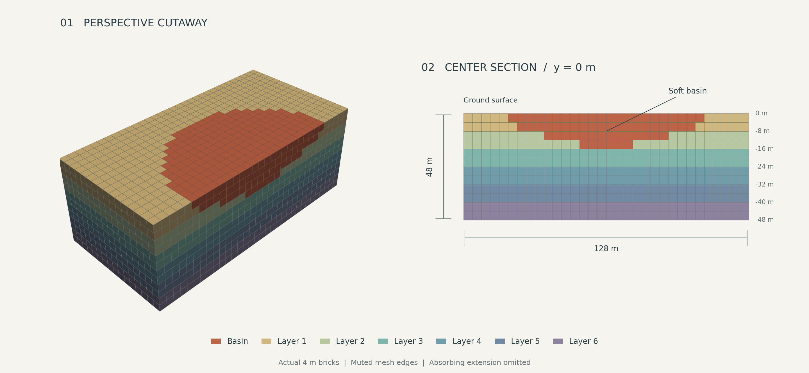

# Elastic and Plastic Basin

Compare a soft elastic basin with a pressure-independent elastoplastic basin
inside the same six-layer elastic background. One setting changes the basin
material; the geometry, density, viscous damping, input, and recording settings
remain unchanged.

A third `no_basin` reference keeps exactly the same extracted cells and mesh
parts, but assigns each basin part its host layer's material, density, and
damping. It therefore represents the original six-layer background without a
soft inclusion. All three cases use the same process steps; each site supplies its own shared DRM input.

!!! warning "Initial migration, not a validated benchmark"
    Geometry previews are not simulation results. Gravity equilibrium,
    implicit convergence and time-step accuracy, DRM compatibility, and absorbing-boundary
    performance must be checked before interpreting a full run.

<div class="tutorial-actions" markdown>
[:material-code-braces: View source](https://github.com/GeotechUW/Femora/blob/main/examples/domain_reduction_method/basin.py){ .tutorial-action .tutorial-action--source }
</div>

| Item | Configuration |
|---|---|
| Units | m, kN, tonne, s; moduli and stresses in kPa |
| Physical domain | 128 x 128 x 48 m |
| Mesh | 4 m bricks; 12,288 physical cells |
| Basin | Sphere center (0, 0, 70) m, radius 85 m, clipped by soil |
| Materials | Elastic host; elastic or PressureIndependMultiYield basin |
| Analysis | Implicit Newmark; ModifiedNewton with factor-once dynamics |
| Time | 27.4 s at all sites; initial integration interval 0.01 s, recording interval 0.02 s |
| Parallel export | 32 physical + 64 absorber partitions = 96 ranks |

## Model

<div class="femora-boundary-schematic">
--8<-- "website/docs/assets/examples/basin/model.svg"
</div>

The basin is a **shallow spherical cap**, not a hemisphere. Its ideal bottom is
at z = -15 m and its surface radius is approximately 48.22 m. Cells are assigned
by their centers, so the actual interface is stepped and the modeled depth is
quantized by the 4 m spacing. Basin and host points are merged during assembly:
this is a continuous soil domain, not a contact interface.

## Inspect the Actual Mesh



The figure is generated by the postprocessor, separately from model construction:

```bash
python examples/domain_reduction_method/basin_postprocess.py --mesh
```
This renders geometry only. Running `basin.py` submits the TACC workflow.

## Worked Model

=== "1. Select the material"

    ```python
    --8<-- "examples/domain_reduction_method/basin.py:settings"
    ```

    Change `BASIN_MATERIAL` to `"plastic"` to use the nonlinear material. Both
    variants use density 1.8 tonne/m3, Vs = 150 m/s, Vp = 300 m/s, G = 40,500 kPa,
    and K = 108,000 kPa. The nonlinear material uses cohesion 8 kPa and peak shear
    strain 0.1; these inherited parameters are illustrative, not a calibration.

    ```python
    --8<-- "examples/domain_reduction_method/basin.py:basin-material"
    ```

=== "2. Build the layers"

    The loop walks downward from z = 0, creates the elastic host material, and
    separates basin cells from host cells. Only the upper two layers intersect
    the basin. No cells are duplicated between the two materials.

    ```python
    --8<-- "examples/domain_reduction_method/basin.py:mesh"
    ```

=== "3. Add the boundary"

    ```python
    --8<-- "examples/domain_reduction_method/basin.py:boundary"
    ```

    The eight-layer Rayleigh absorbing extension retains the legacy damping
    setting of 0.95. This is separate from physical-soil damping and requires
    reflection checks; it is not a claim of perfect absorption. The free surface
    has no absorber above it. Eight 4 m rows extend 32 m at each side and below.

=== "4. Initialize and record"

    Physical strata use their listed viscous damping ratios, fitted at 3 and
    15 Hz; the basin uses 3% in both variants. Plastic hysteresis adds dissipation
    on top of this common viscous damping. Self-weight is enabled in the bricks.
    The plastic basin is initialized elastically, switched to plastic, and
    equilibrated again before DRM excitation. Check residual velocities and
    equilibrium before accepting that initialization.

    ```python
    --8<-- "examples/domain_reduction_method/basin.py:analysis"
    ```

## TACC Workflow

The model script follows the same submission format as the other migrated
examples: `build_workflow()` defines the stages and the final `fm.submit(...)`
block specifies the cluster settings. No command-line options are required.

=== "1. Configure"

    `FINAL_TIME = 27.4` near the top selects the shared duration. The workflow
    builds elastic, plastic, and no-basin cases for Site1, Site2, and Site3.
    `DRM_ROOT` points to `/scratch/08189/amnp95/drm_inputs`, containing the
    three community records copied from Corral on the login node. This
    scratch copy is needed because the compute nodes could not access Corral.
    No new DRM input is generated or uploaded. Other users must change
    `DRM_ROOT` to their own compute-accessible input directory.
    Edit the app, allocation, queue, nodes, and minutes directly in the
    submission block to match your account.

    ```python
    --8<-- "examples/domain_reduction_method/basin.py:submission"
    ```

=== "2. Submit"

    From the repository root in your configured Femora environment:

    ```bash
    python examples/domain_reduction_method/basin.py
    ```

    This submits a job and prompts for DesignSafe authentication as needed.
    Defaults are Stampede3, `skx`, six 48-core nodes, and 240 minutes.
    Each site's three 96-rank solves run concurrently, using all 288 cores.
    The three site groups run sequentially and reuse the same allocation.
    Python stages remain sequential one-core callbacks.

    The three existing Hayward-fault SW4 records have matching box bounds
    (-64 to 64 m horizontally, -48 to 0 m vertically) and 4 m spacing.
    Their sample interval is 0.010778281762249068 s; the solver's initial
    0.01 s integration step is independent of this interval. Coordinates
    remain unchanged and the DRM load factor remains 1.0.

    Newmark uses gamma = 0.5 and beta = 0.25, Mumps, and
    ModifiedNewton with `factor_once=True`. The fixed tangent can struggle
    during plastic yielding. Each failed increment gets one same-step retry,
    then up to three halving levels (down to 0.00125 s). Factor-once reuse
    resets whenever the integration step changes, including the return to
    0.01 s. The analysis stops if recovery fails. A short smoke
    run should establish convergence before the full-duration run. Site2 and
    Site3 lack a velocity dataset; confirm the installed H5DRM reader accepts
    them. Motion units and site fault distances are not inferred from filenames.

=== "3. Inspect"

    ```bash
    femora jobs track
    ```

    Download the small acceleration plot, 27 probe-history CSV files,
    `summary.json`, solver logs, and exported Tcl. Surface probes are at
    (0, 0, 0), (48, 0, 0), and (60, 0, 0) m. The reducer checks completion,
    timestamps, coordinates, and finite acceleration and displacement.
    Inspect the peaks and solver warnings before accepting the run.

    `center_acceleration_all_cases.csv` combines the center-surface acceleration
    for all nine cases. Its columns are `case,time_s,ax_m_per_s2,ay_m_per_s2,az_m_per_s2`.
    Each case retains its own recorded timestamps; no interpolation is applied.

    Raw VTKHDF stays under `build/site1_elastic/results` and the eight
    corresponding site/material folders
    in the remote workspace, outside the default download package.

=== "4. Extend"

    For a short smoke test, temporarily set `FINAL_TIME = 2.0`; restore
    `27.4` for the full comparison. Adjust `minutes` in `fm.submit(...)`
    based on measured timings for the three sequential site groups.

    The model and postprocessor are staged from your local files. The remote
    Femora installation and OpenSeesMP must already provide the APIs and
    VTKHDF recorder used by the example.

```python
--8<-- "examples/domain_reduction_method/basin.py:workflow"
```

## Differences from the Legacy Examples

This consolidates `DRM/Example3` and `DRM/Example6` as a controlled comparison,
not an exact reproduction of either. It uses density 1.8 rather than the plastic
legacy value 1.3, enables physical viscous damping by default, uses consistent
mass throughout, adopts eight absorber layers and 96 ranks, and uses the same
common implicit analysis for all cases. Self-weight is now active instead of the zero
body forces in the legacy plastic example. The obsolete
`updatewithsigmav0` constructor argument is not carried over.

Set `NO_PHYSICAL_DAMPING = True` to disable basin and host viscous damping
without changing absorber damping. Both gravity phases use ten static
zero-load-increment steps with 30 iterations and no retries: the elastic
phase uses tolerance `1e-8` and factor-once Modified Newton; the subsequent
re-equilibration uses `1e-5` and plain Modified Newton. These steps correct
equilibrium at fixed body-force loading rather than ramping self-weight.
Dynamics use tolerance `1e-4` and eight iterations in all three cases.
The installed remote Femora exporter must include the time-step-dependent
factor-once reset for this recovery behavior.

## Planned Response Comparisons

After short runs establish numerical behavior, compare surface acceleration
at the center, near the basin edge, and outside the basin; deformation; and
representative basin stress-strain histories. The VTKHDF recorder requests
displacement, velocity, acceleration, stress, and strain. Verify the installed
solver's tensor output conventions before building those comparisons. No
validated response plots or experimental validation are claimed yet. The
workflow's initial acceleration comparison is a smoke diagnostic only.

The companion `basin_postprocess.py` contains response plotting and the
documentation mesh renderer. Recreate the mesh figure with:

```bash
python examples/domain_reduction_method/basin_postprocess.py --mesh
```
