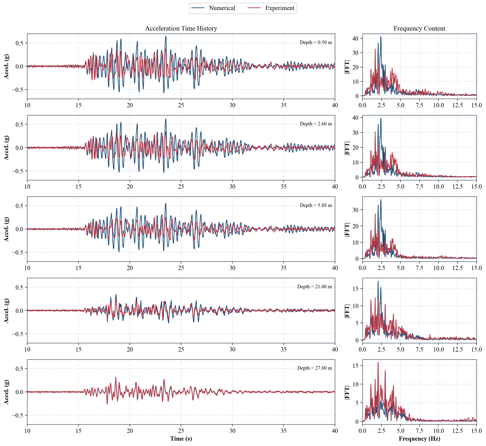
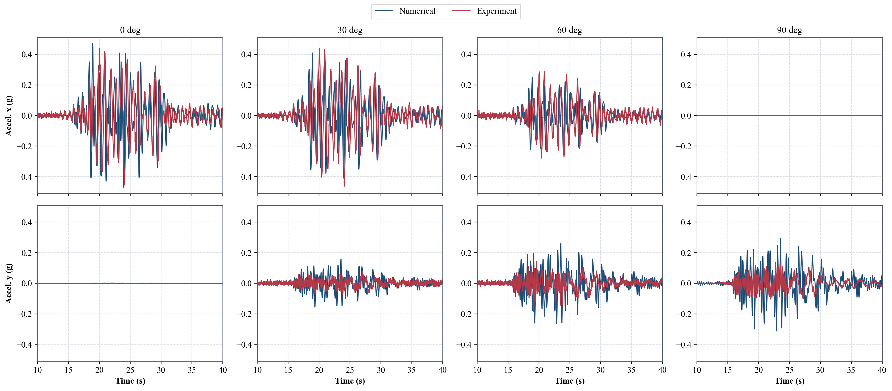
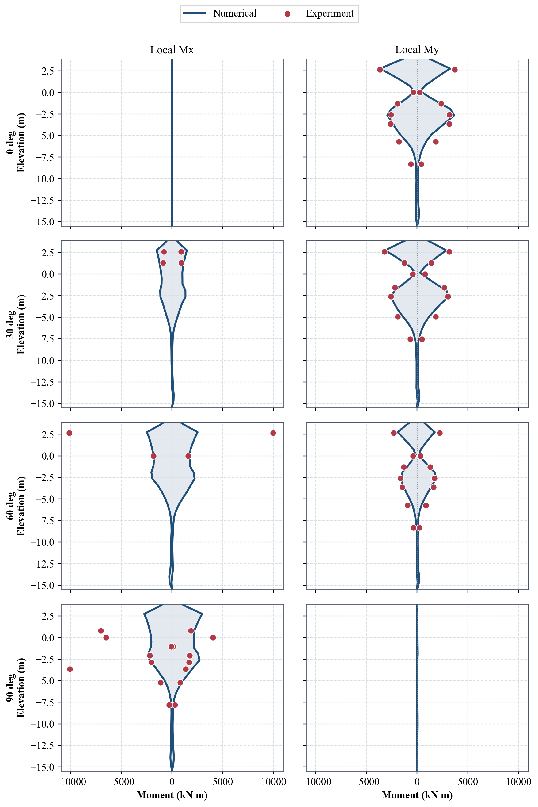

# Rotated Two-Pile Bent

This example applies the same base motion to four configurations of a
two-pile aluminum bent. The bent's plan orientation rotates relative to the shaking direction,
and the assigned pile yield strength also follows the thesis validation cases.
It therefore compares those four configurations, not the isolated effect of
rotation. All four cases share one Femora workflow.

The bent assembly is rotated about the vertical axis to four angles:
0 deg (aligned along the global-x shaking direction), 30 deg, 60 deg, and 90 deg
(oriented transversely to shaking). The input motion stays in global x.
Each orientation is solved concurrently as
an independent remote case within a single Femora workflow.

<div class="tutorial-actions" markdown>
[:material-code-braces: View source](https://github.com/GeotechUW/Femora/blob/main/examples/soil_structure_interaction/rotated_two_pile_bent.py){ .tutorial-action .tutorial-action--source target="_blank" rel="noopener" }
</div>

## Model


The domain is a 30 m by 30 m soil block extending 28 m deep. Standard brick
elements (`stdBrick`) use 1 m horizontal spacing. Vertically, the mesh has
7 elements from -28 to -14.3 m, 13 from -14.3 to -1 m, and one from -1 to 0 m.
All three parts use a drained, pressure-dependent multi-yield soil material.
The boundaries enforce laminar shear-box kinematic constraints
along depth, simulating a physical shaking box rather than an infinite
domain with absorbing boundaries. This is a drained solid-element model,
not a coupled pore-pressure or liquefaction analysis.
[OpenSees material reference](https://opensees.berkeley.edu/OpenSees/manuals/usermanual/1550.htm).

The structure consists of:

- **Hollow circular aluminum piles:** Two vertical piles extending from
  $z = -14.3\text{ m}$ to $z = +5.6\text{ m}$ ($19.9\text{ m}$ total length,
  discretized into 27 displacement-based beam-column elements: 19 in the soil,
  six above ground, and two inside the cap). The section is
  modeled using a fiber discretization with aluminum properties ($E = 68.9\text{ GPa}$,
  $\nu = 0.33$), outer
  radius $r_o = 0.4953\text{ m}$, and inner radius $r_i = 0.449072\text{ m}$.
  The validation configuration uses $F_y = 255\text{ MPa}$ at 0 and 90 degrees,
  and $130\text{ MPa}$ at 30 and 60 degrees. Thus the four responses differ in
  both orientation and assigned strength, not orientation alone. In the
  reference configuration, piles are centered at $x = \pm 3.809\text{ m}$, $y = 0$.
- **Solid aluminum cap:** A solid 3D brick mesh ($11.44\text{ m} \times 6.24\text{ m} \times 3.38\text{ m}$,
  from $z = 3.9\text{ m}$ to $z = 7.28\text{ m}$) rather than a 1D line beam.
  The cap provides distributed structural mass and stiffness directly through
  its solid continuum elements. Its density is $2700\text{ kg/m}^3$; its brick
  mass matrix is lumped, with no separate point mass added. Buried pile segments
  use $2700\text{ kg/m}^3$; segments above grade use an effective line mass of
  $909\text{ kg/m}$. The pile beam elements use a
  `PDelta` geometric transformation.
- **Embedded beam-solid interfaces:** The two piles couple to soil below
  $z=-1\text{ m}$ and separately to the cap. The upper 1 m of soil remains in
  the model but is intentionally **not coupled to the piles**, representing an
  approximately one-diameter free length below grade. This is a zero-transfer
  idealization, not a gap-contact law that can re-engage.

The soil has frequency-based Rayleigh damping calibrated to 5% at 0.2 and 20 Hz,
and the pile/cap region uses a 7% Uniform damping object over 2.2-15 Hz.
These are prescribed
model parameters, not values calibrated by this example.

!!! warning "Interface Sampling Radius vs. Physical Outer Radius"
    The physical pile outer radius is $0.4953\text{ m}$, while the interface
    sampling radius follows the thesis value $1.181 / 2 = 0.5905\text{ m}$.
    The larger sampling radius is intentional and must not be interpreted as
    the pile's structural section radius.

!!! note "SI Unit Conversions"
    All input parameters are converted to consistent SI units ($\text{m}$, $\text{N}$,
    $\text{kg}$, $\text{s}$). The soil reference shear modulus is $G = 1.0 \times 10^8\text{ Pa}$
    and bulk modulus is $K = 3.0 \times 10^8\text{ Pa}$ at a reference mean stress
    $p'_r = 80\text{ kPa}$ (with atmospheric pressure $p_a \approx 101\text{ kPa}$).
    The pressure threshold `liquefac1` is 5,000 Pa and `pa` is 101,000 Pa.
    Pressure-valued defaults must use the same units as the moduli.

## Base Excitation and Analysis Stages

The model uses a prescribed global-$x$ base acceleration from the input
record `CFG2_ax_base_02g_avg.acc` (4,096 samples at $\Delta t = 0.0127\text{ s}$).
Scaled by $+9.81\text{ m/s}^2$, the record has an actual peak base acceleration
of approximately $0.286\text{ g}$, not exactly 0.2 g despite its filename.
Event and processing metadata are not supplied, so we do not assign this
record an earthquake name.

The numerical solution proceeds through three consecutive stages:

1. **Elastic gravity settling:** 100 steps ($\Delta t = 1.0\text{ s}$) with soil
   materials set to their linear elastic stage and numerical Newmark damping
   ($\gamma = 0.6$, $\beta = 0.3025$).
2. **Plastic gravity settling:** 500 steps with time increments ramping from
   0.001 to 0.1 s, with soil switched to its elastoplastic stage.
3. **Dynamic excitation:** Pseudo-time is reset to $0.0\text{ s}$ while preserving
   accumulated stresses and strains, after which the 50 s dynamic base motion
   is applied using explicit differences at $\Delta t=4\times10^{-5}\text{ s}$.

The gravity state is retained, but the specified settling steps alone do not
prove equilibrium. Check residual motion and convergence before interpreting
the shaking response. Gravity permits up to ten same-step retries, without subdivision; a failed
dynamic step stops the job rather than silently continuing.

Recorded displacements under uniform base excitation represent motion relative
to the moving base. Raw histories retain the initial offset from gravity
settlement. They are not absolute ground-plus-structure motion.
[OpenSees uniform excitation reference](https://opensees.github.io/OpenSeesDocumentation/user/manual/model/pattern/uniformExcitationPattern.html).

## Model Construction

The tabs below present the core model construction blocks from
`rotated_two_pile_bent.py`.

=== "1. Soil"

    Construct the three soil mesh parts using standard brick elements and
    one pressure-dependent multi-yield material throughout.

    ```python
    --8<-- "examples/soil_structure_interaction/rotated_two_pile_bent.py:soil"
    ```

=== "2. Piles"

    Define the hollow circular fiber section, `PDelta` transformation, and
    the soil, free, and cap beam segments for both piles.

    ```python
    --8<-- "examples/soil_structure_interaction/rotated_two_pile_bent.py:piles"
    ```

=== "3. Cap"

    Discretize the elevated solid cap using continuum brick elements and apply
    the specified orientation rotation about the vertical axis.

    ```python
    --8<-- "examples/soil_structure_interaction/rotated_two_pile_bent.py:cap"
    ```

=== "4. Interfaces"

    Couple the buried piles below -1 m to soil and the upper pile segments
    separately to the cap. Leave the upper 1 m soil mesh uncoupled to the piles.

    ```python
    --8<-- "examples/soil_structure_interaction/rotated_two_pile_bent.py:interfaces"
    ```

=== "5. Gravity"

    Configure the two-stage gravity initialization to establish self-weight
    equilibrium before dynamic shaking begins.

    ```python
    --8<-- "examples/soil_structure_interaction/rotated_two_pile_bent.py:gravity"
    ```

    Add the two analyses to the model process in order. The material-stage
    actions change the soil behavior; they do not rebuild the mesh.

    ```python
    --8<-- "examples/soil_structure_interaction/rotated_two_pile_bent.py:gravity-process"
    ```

=== "6. Excitation"

    Define the sampled motion and the uniform-excitation pattern. The model
    process adds this pattern after gravity, then registers the recorders and
    resets time before dynamic analysis. There is no explicit load-freezing
    action; self-weight remains assigned through element body forces. Neither
    the deformed configuration nor the material state is reset.

    ```python
    --8<-- "examples/soil_structure_interaction/rotated_two_pile_bent.py:excitation"
    ```

=== "7. Dynamic Analysis"

    Advance the model with Femora's explicit transient analysis. The parallel
    diagonal solver avoids a full matrix factorization at each small time step;
    a failed step stops the run.

    ```python
    --8<-- "examples/soil_structure_interaction/rotated_two_pile_bent.py:dynamic"
    ```

## Results

The workflow automatically reduces the four solved configurations and generates
the comparisons below. Blue curves show numerical responses; red curves or
markers show experimental measurements. Full-domain fields are not needed to
download and inspect these comparisons. The compact numerical file retains
acceleration histories and signed element-end moments for both piles, allowing
the figures to be regenerated locally.

=== "Free-Field Soil Response"

    

    The left column compares acceleration histories at four soil depths and at the
    base for the 0-degree configuration. The right column compares their frequency
    content. The prescribed base history closely follows the experimental input,
    but this is an input consistency check rather than an independent prediction.
    At 21 m depth the response follows the measured motion more closely than in the
    shallow soil. At 0.5, 2.6, and 5.88 m, numerical peaks are visibly larger and
    the spectral response is more concentrated around 2-3 Hz. The model captures
    the main shaking interval but overpredicts shallow-soil amplification.

    Depth labels refer to requested experimental sensor depths. The nearest
    numerical nodes are at 1.000, 3.046, 6.115, and 20.171 m depth for requests
    of 0.5, 2.6, 5.876, and 21 m, respectively. Histories are not spatially
    interpolated to sensor elevations, which limits this comparison.
    The spectra use mean removal and a Hann window over 10-40 s. Their plotted
    FFT magnitudes are not normalized for sample count or window gain; compare
    frequency locations, not absolute spectral amplitudes across sampling rates.

=== "Bent-Top Acceleration"

    

    Columns represent the 0, 30, 60, and 90-degree configurations; rows show the
    two bent-local horizontal components. Longitudinal histories at 0 and 30 degrees
    reproduce much of the measured timing and amplitude, although individual peaks
    differ. The 60-degree longitudinal response is smaller, with visible phase and
    amplitude differences. Numerical transverse peaks are larger than the measured
    curves at 30, 60, and 90 degrees. Since assigned pile strength also varies,
    these differences cannot be attributed to orientation alone.

    Acceleration is shown in g. The postprocessor adds the prescribed base motion
    to the relative numerical acceleration before rotating into bent-local axes.
    Experimental time is shifted by 11.45 s; the figures display 10-40 s.
    The numerical probe is the mesh node nearest the cap-top center, not an
    interpolated center response. In the 0-degree case it is at
    $(-0.52, 0, 7.28)\text{ m}$.

    !!! warning "Experimental Component Conventions"
        The transverse experimental channel is named `ay_global`, whereas the
        numerical curve uses bent-local y. Its measurement-axis convention needs
        confirmation before interpreting transverse agreement quantitatively.
        Missing experimental acceleration channels currently appear as zero curves;
        a flat red line must not be interpreted as a measured zero response without
        checking channel availability.

=== "Pile Bending Moments"

    

    The curves show minimum and maximum left-pile bending moments along elevation;
    red markers are experimental envelopes at instrumented elevations. Moments are
    in kN m. The dominant component changes from local My at 0 degrees to local Mx
    at 90 degrees, with both components active at intermediate orientations.
    Local My envelopes at 0 and 30 degrees follow the measured depth-wise shape
    reasonably, but disagreement remains at individual elevations. The large
    60-degree local Mx measurements near the upper pile are not reproduced, and
    the 90-degree Mx envelope also differs from several measured values.

    For plotting, duplicate element-end elevations are averaged and the existing
    elevation shift of -1.15 m is applied. Envelopes use the full recorded
    0-50 s history, unlike the acceleration plots' 10-40 s display window.
    The compact file preserves unaveraged
    signed end moments. These figures demonstrate the comparison workflow and its
    remaining model discrepancies, not exact agreement or complete validation.


## Workflow and Execution

Femora coordinates model generation, parallel numerical solution, and
cross-case response postprocessing using a structured workflow. For general
workflow concepts and execution modes, see the
[Workflows and Remote Execution](../concepts/workflows.md) guide.

The workflow builds all four cases (`angle_000`, `angle_030`, `angle_060`, `angle_090`)
sequentially, solves each case on 33 MPI ranks (one structural and 32 soil;
132 ranks concurrently across the study),
and passes the resulting partition datasets to the companion postprocessor:

```python
--8<-- "examples/soil_structure_interaction/rotated_two_pile_bent.py:workflow"
```

### Remote Submission

Run the study directly on DesignSafe / TACC systems using Femora's remote submission
interface:

```python
--8<-- "examples/soil_structure_interaction/rotated_two_pile_bent.py:submission"
```

Submit from the command line:

```bash
python examples/soil_structure_interaction/rotated_two_pile_bent.py
```

Once submitted, monitor job progress or inspect intermediate logs using the
CLI tool:

```bash
femora jobs track
```

Select the submitted job in the tracker. After solving, the postprocessor
extracts compact histories and generates experimental comparison plots remotely.
The download package includes the reduced HDF5 file, comparison plots, model Tcl,
motion input, and logs. Raw VTKHDF and pile-force XML files are not selected for
download; they remain in the remote workspace subject to cluster retention.

To regenerate plots locally from the downloaded reduced file:

```bash
python examples/soil_structure_interaction/rotated_two_pile_bent_postprocess.py plot \
  --numerical-file rotated_bent_numerical.h5 --output post_processing
```
