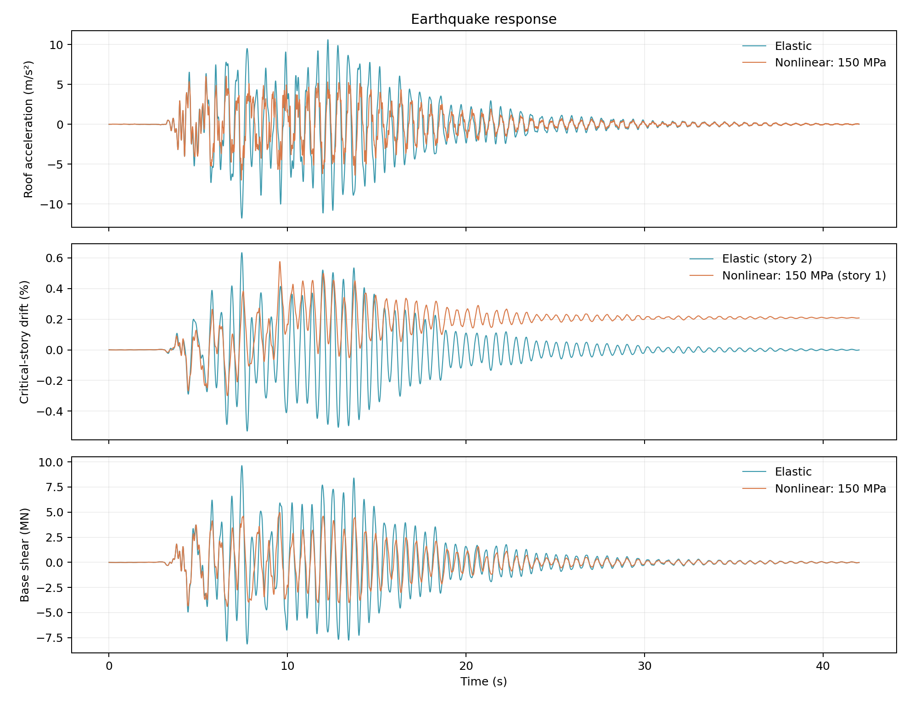

# Steel Braced Frame: From Model to Response

This example shows how to use one of Femora's building classes to create a
structural model and work with it throughout an analysis. We use
`SteelConcentricallyBracedFrame3D` to define a steel braced building, obtain its
loads and recorders, and read its response.

These operations belong to the building instance: its load methods generate
patterns for its geometry and floor masses, its recorder selects its members,
and its results interface identifies its floors, beams, columns, and braces.
The building supplies these objects; the Femora process controls when they
are applied and which analyses run.

We demonstrate the workflow through modal, pushover, and earthquake analyses
with a fixed base. The same building definition can later be incorporated into
a soil model. A subsequent example will extend this workflow to soil–structure
interaction.

<div class="tutorial-actions" markdown>
[:material-code-braces: Model source](https://github.com/GeotechUW/Femora/blob/main/examples/buildings/steel_concentrically_braced_frame_3d.py){ .tutorial-action .tutorial-action--source }
[:material-chart-line: Postprocessor source](https://github.com/GeotechUW/Femora/blob/main/examples/buildings/steel_concentrically_braced_frame_3d_postprocess.py){ .tutorial-action .tutorial-action--source }
</div>

## Meet the Building

Rotate the frame to see its columns, floor beams, and perimeter X-braces.
Three 8 m bays in each direction give a 24 m by 24 m plan. Five stories
give a total height of 18 m.

<iframe src="../../assets/viewer/viewer.html?scene=../scenes/steel-braced-frame.js&amp;variant=default&amp;fallback=../examples/steel-braced-frame/default.png" title="Five-story steel braced frame" loading="lazy" style="width:100%;height:clamp(360px,65vw,680px);border:0"></iframe>

The dashed outlines identify the floors; they are not slab elements.
Each floor has a concentrated mass at its center. A rigid diaphragm will connect
that mass node to the floor joints, allowing the floor to move horizontally
and twist as one plane.

The braces carry axial force. Beams and columns use force-based beam-column
elements. With nonlinear materials, the steel can yield; brace buckling is
not included in this example.

## Define Your Frame

The model script starts with editable settings. Choose the analysis and whether
the steel should behave elastically or nonlinearly:

```python
--8<-- "examples/buildings/steel_concentrically_braced_frame_3d.py:settings"
```

Next, describe the building. Bay lengths set the plan grid; story heights
set the floor elevations. Supply one height and one floor mass per story.

```python
--8<-- "examples/buildings/steel_concentrically_braced_frame_3d.py:geometry"
```

Units are **m, kN, tonne, and s**. The listed floor masses are additional masses,
not weights. The members also have mass based on their section areas and
steel density.

### Sections Come From AISC

You do not need to calculate the W-section or HSS properties yourself.
The building uses Femora's AISC section tools to look up the named geometry
and torsional constant `J`. Beams and columns use fiber sections for both
material choices: uniaxial Elastic gives elastic behavior, while Steel01
allows the same section to yield. Braces use the material in axial sections.

Change `column_sections`, `beam_sections`, or `brace_sections` to choose
other sizes. For more options, see the
[AISC section tools](../reference/tools/sections/aisc.md) and the
[building API reference](../reference/tools/buildings/SteelConcentricallyBracedFrame3D/index.md).

## Build and Support It

Create one uniaxial material and pass it to the building. With `nonlinear=True`,
Steel01 gives the fibers and braces a yield strength and a post-yield hardening
ratio. Otherwise, uniaxial Elastic supplies an elastic stress–strain law.

```python
--8<-- "examples/buildings/steel_concentrically_braced_frame_3d.py:materials"
```

Here, `yield_strength=150000` means 150 MPa, and `b=0.01` gives 1% hardening.
The lower strength makes plastic response easier to see. Set
`yield_strength=345000` for the stronger steel used in the control-method
comparison below. Switching `nonlinear=False` changes the material law,
not the fiber-section formulation.

Two separate inputs complete the member definition: `G` supplies elastic
torsion through `GJ`, and `material_density` supplies member masses and
rotational inertias. No nD material, Poisson ratio, or separate reference
modulus is needed. Member mass uses the assigned AISC area and inertias;
floor masses remain separate from member mass.

`build()` creates this building's members in the Femora model. Assemble them,
then apply its supports and floor constraints:

```python
--8<-- "examples/buildings/steel_concentrically_braced_frame_3d.py:assembly"
```

`apply_fixed_base()` restrains the base joints.
`create_rigid_diaphragms()` creates the diaphragm constraints for this building,
connecting its structural floor joints to its floor mass nodes.

Call mesh-dependent methods after `assemble()`: supports, diaphragms, load
patterns, and recorders inspect the complete assembled mesh to identify this
building's nodes and members. The sequence shown is a workflow example, not
a prescribed order for all of those helper calls.

## Establish Gravity Equilibrium

`create_gravity_pattern()` returns a gravity-load pattern for this building's
floor masses and joints. Add that pattern to the process, followed by the
static analysis that establishes equilibrium under those loads.

```python
--8<-- "examples/buildings/steel_concentrically_braced_frame_3d.py:gravity"
```

Pass `g=9.81` as a positive magnitude; the method applies the downward sign.
It distributes the supplied floor weights over the floor joints, without
adding member self-weight loads.

After equilibrium, `load_const()` holds gravity constant. Resetting the
analysis clock prepares the model for the lateral loading that follows.
The building is now carrying its floor weights and is ready for either
sample analysis below.

## Explore How It Vibrates

Set `calculate_modes=True` to calculate six modes.
`get_modes()` runs an isolated building calculation with OpenSees and returns
the frequencies, periods, and mode shapes. The script uses an Elastic uniaxial
material with the same fiber geometry, `G`, and density, and uses its first
frequency for earthquake damping.

```python
--8<-- "examples/buildings/steel_concentrically_braced_frame_3d.py:modes"
```

Select a mode, animate it, and rotate the view. Look for horizontal sway
and twisting. The deformation is enlarged so the pattern is easy to see.

<iframe src="../../assets/viewer/viewer.html?scene=../scenes/steel-braced-frame.js&amp;variant=default&amp;modes=1&amp;fallback=../examples/steel-braced-frame/mode-1.png" title="Calculated mode shapes of the five-story frame" loading="lazy" style="width:100%;height:clamp(400px,70vw,740px);border:0"></iframe>

These modes are calculated for the current force-based elastic reference.
Its first period is approximately **0.55 s**. The two horizontal directions
have similar periods because the plan and bracing are nearly symmetric.
`plot_modes=True` also opens the mode-shape plots in Python.

## Choose What to Record

`get_recorders()` returns one VTKHDF recorder for this building's members and
connected nodes. It records displacement, velocity, acceleration, and global/local
member-end forces. Adding it to the process determines when recording starts.
For earthquake response, declare that the recorded acceleration is relative
to the ground:

```python
--8<-- "examples/buildings/steel_concentrically_braced_frame_3d.py:recorder"
```

The pushover branch uses the same recorder API, with
`abscissa="load_factor"` instead. Each branch defines one recorder for its
selected analysis.

## Apply Lateral Loading

Now use the same building interface for two sample analyses. Each starts from
gravity equilibrium: pushover uses a lateral pattern supplied by the building,
while earthquake analysis applies a ground-motion pattern to the model.

=== "Pushover"

    Set `analysis_type="pushover"`. `create_pushover_pattern()` returns a
    lateral-load pattern for this building's floors and mass nodes.
    `distribution="mass_height"` puts more force on floors with greater
    mass and height.

    ```python
    --8<-- "examples/buildings/steel_concentrically_braced_frame_3d.py:pushover-load"
    ```

    The 1,000 kN resultant defines the reference pattern. The analysis
    calculates how much that pattern must be multiplied to reach each
    equilibrium state.

    ### Choose How to Push

    With displacement control, prescribe roof movement and solve for force.
    The default 60 steps reach a roof displacement of 180 mm, or 1% of
    the building height.

    With load control, prescribe increments of lateral force and solve for
    movement. Select it with `push_control="load"` and choose
    `target_base_shear`.

    ```python
    --8<-- "examples/buildings/steel_concentrically_braced_frame_3d.py:pushover-control"
    ```

    The static analysis uses the chosen integrator. Newton iterations
    find equilibrium as the steel changes stiffness.

    ??? "Pushover solver settings"

        ```python
        --8<-- "examples/buildings/steel_concentrically_braced_frame_3d.py:pushover-analysis"
        ```

=== "Earthquake"

    Set `analysis_type="earthquake"`. The supplied Kobe record gives
    acceleration in g; multiply by 9.81 to use m/s². A uniform-excitation
    pattern applies this motion in the global X direction.

    ```python
    --8<-- "examples/buildings/steel_concentrically_braced_frame_3d.py:earthquake-load"
    ```

    The script preserves the supplied timestamps. It also saves
    `ground_motion.csv` so the postprocessor can recover absolute
    acceleration later.

    ### Add Damping and Integrate

    Mass-proportional damping gives 2% damping at the elastic reference's
    first mode:

    ```python
    --8<-- "examples/buildings/steel_concentrically_braced_frame_3d.py:damping"
    ```

    Newmark integration advances the response in 0.01 s steps. The analysis
    continues to 42.01 s, including a short free-vibration tail after
    the ground motion.

    ??? "Earthquake solver settings"

        ```python
        --8<-- "examples/buildings/steel_concentrically_braced_frame_3d.py:earthquake-analysis"
        ```

## Run the Model

After defining the recorder and the chosen response analysis, add them to the
process in that order. Close the recorder after the analysis finishes:

```python
--8<-- "examples/buildings/steel_concentrically_braced_frame_3d.py:process"
```

Finally, explicitly export the building information needed to identify
floors and members later, followed by the Tcl model:

```python
--8<-- "examples/buildings/steel_concentrically_braced_frame_3d.py:export"
```

Run from the repository root:

```bash
python examples/buildings/steel_concentrically_braced_frame_3d.py
OpenSees example_outputs/frame_earthquake_nonlinear/model.tcl
```

Use the Tcl path printed by the script; its folder reflects the selected
analysis and material choice. To calculate modes, put OpenSees on your system
path or set `FEMORA_OPENSEES` to its executable.

## Read the Building Response

The results interface carries the building's floor and member identities into
postprocessing. You do not need to reconstruct those roles from element geometry.

If you still have the model and building in the same Python session, use
the building's `get_results()` method to open its recorded response:

```python
with building.get_results(str(output / "results/response*.vtkhdf")) as results:
    drift = results.interstory_drift("x")
    shear = results.base_shear("x")
```

The separate postprocessor opens the saved files using `BuildingResults`.
Set `case` to the output folder you want to inspect:

```python
--8<-- "examples/buildings/steel_concentrically_braced_frame_3d_postprocess.py:read-results"
```

The methods return DataFrames. `floor_displacement()` gives a history for
each floor, `interstory_drift()` gives relative floor movement divided by
story height, and `base_shear()` sums member-end forces at the base cut,
including braces. For individual member forces, use
`results.member_forces(kind="brace")`, `"beam"`, or `"column"`.

Save the histories and their peak-response summary:

```python
--8<-- "examples/buildings/steel_concentrically_braced_frame_3d_postprocess.py:export-results"
```

Then run the postprocessor:

```bash
python examples/buildings/steel_concentrically_braced_frame_3d_postprocess.py
```

It creates a pushover curve or earthquake time histories, along with CSVs
in `processed/`. For earthquake acceleration, it adds the saved ground
input once to the recorded relative motion.

## Understand the Response

The following results show what to look for after running the example.

=== "Pushover"

    ### Watch the Response

    Move the slider to follow the nonlinear frame's recorded deformation.
    The viewer enlarges the movement; the displayed roof displacement
    and base shear are the calculated values.

    <iframe src="../../assets/viewer/viewer.html?scene=../scenes/steel-braced-frame.js&amp;variant=default&amp;response=pushover&amp;fallback=../examples/steel-braced-frame/default-pushover.png" title="Nonlinear pushover of the 150 MPa five-story frame" loading="lazy" style="width:100%;height:clamp(400px,70vw,740px);border:0"></iframe>

    
    

    Initially, force increases almost proportionally to displacement.
    As the steel yields, the curve bends and the tangent stiffness falls.
    At 180 mm roof displacement, this 150 MPa frame carries approximately
    **5.20 MN** of base shear.

    ### Compare the Control Methods

    The following comparison uses the stronger **345 MPa** frame.
    Set `yield_strength=345000`, `push_steps=100`, and
    `target_base_shear=11000`. Keep `roof_drift=0.01` for displacement
    control. Run each control method in a separate output folder.

    
    

    Both methods follow almost the same force-displacement curve.
    Displacement control reaches **180 mm at 10.98 MN**; load control
    reaches **11.00 MN at 181.8 mm**. Their analysis steps differ because
    one prescribes movement and the other prescribes force.

    Displacement control is a useful starting point when you want to
    follow the building beyond its initial elastic response.

=== "Earthquake"

    ### Compare Elastic and Nonlinear Response

    Run once with `nonlinear=False` and once with `nonlinear=True`.
    The same geometry, masses, input motion, and damping coefficient
    are used in both cases. The nonlinear frame uses 150 MPa steel.

    

    The nonlinear frame develops lower peak acceleration and base shear,
    while retaining permanent deformation. Its final roof displacement
    is approximately **21.2 mm**, compared with **0.09 mm** for the elastic
    frame.

    The middle panel shows the largest-drift story in each model:
    story 2 for the elastic frame and story 1 for the nonlinear frame.
    Yielding changes how the deformation is distributed between stories.

## Make It Your Own

Now change the geometry while keeping the same workflow. These two layouts
show how the constructor controls the resulting frame.

=== "Shorter Frame"

    ```python
    geometry.update(
        num_stories=3,
        x_bays=[6, 6],
        y_bays=[8, 8],
        story_heights=[4, 3.5, 3.5],
        floor_masses=[180, 180, 150],
    )
    ```

    <iframe src="../../assets/viewer/viewer.html?scene=../scenes/steel-braced-frame.js&amp;variant=lowrise&amp;fallback=../examples/steel-braced-frame/lowrise.png" title="Three-story frame with shorter bays" loading="lazy" style="width:100%;height:clamp(360px,65vw,680px);border:0"></iframe>

=== "Taller Frame"

    ```python
    geometry.update(
        num_stories=8,
        x_bays=[8, 8, 8],
        y_bays=[6, 6],
        story_heights=[4] + [3.5] * 7,
        floor_masses=[200] * 7 + [160],
        brace_pattern="single_diagonal",
    )
    ```

    <iframe src="../../assets/viewer/viewer.html?scene=../scenes/steel-braced-frame.js&amp;variant=tall&amp;fallback=../examples/steel-braced-frame/tall.png" title="Eight-story frame with single-diagonal bracing" loading="lazy" style="width:100%;height:clamp(360px,65vw,680px);border:0"></iframe>

Apply these changes immediately after defining `geometry`, before calculating
modes or constructing the building. Set `calculate_modes=True` to update
the reference frequency for your new frame.

You can also change section sizes or brace locations without rewriting the
analysis. The [building API reference](../reference/tools/buildings/SteelConcentricallyBracedFrame3D/index.md)
describes per-story sections, selected braced bays, material options, and
the other building methods.

For mixed member properties, `member_options` can override the uniaxial
material, `G`, and density for beam or column categories. Braces can override
their axial material and density. Unspecified values inherit the build inputs.

This building definition is also the starting point for the next soil–structure
interaction example. Instead of fixing the base joints, we will connect the
building to a foundation and soil model, while retaining its building-specific
load, recording, and results interfaces.
